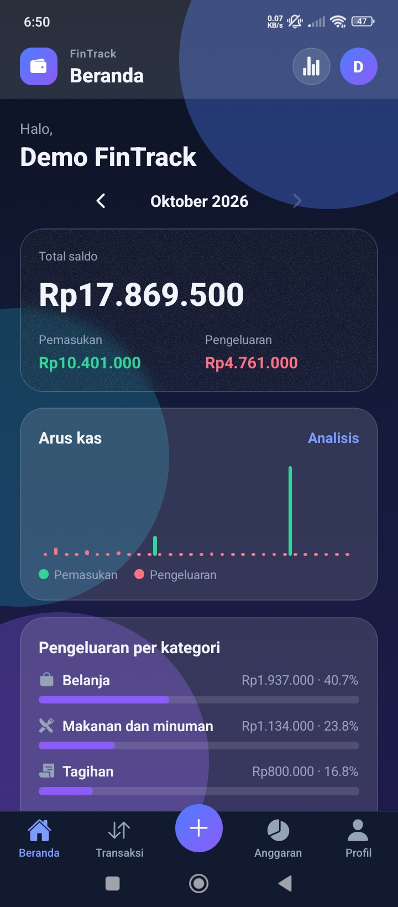
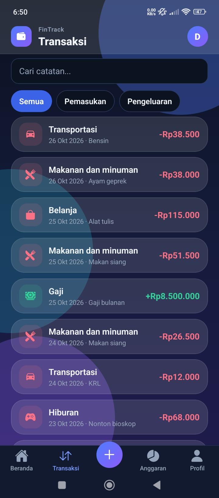
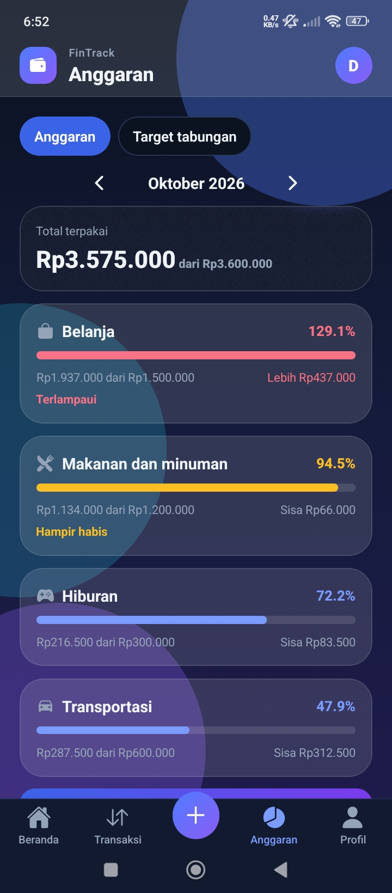
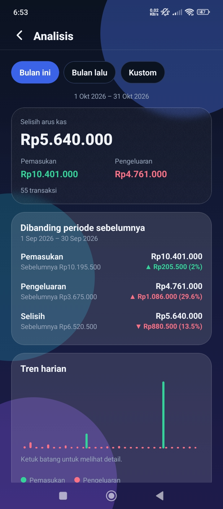
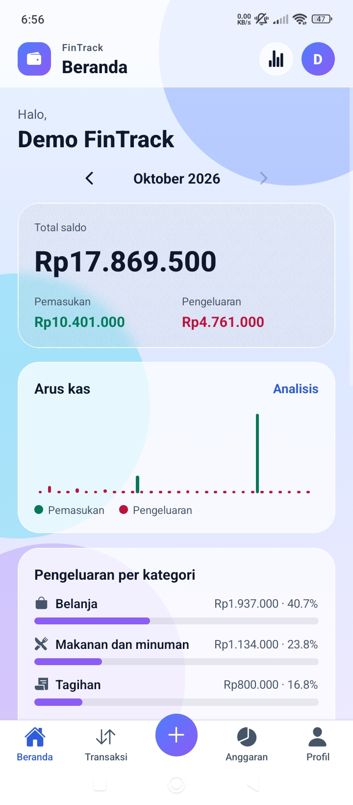
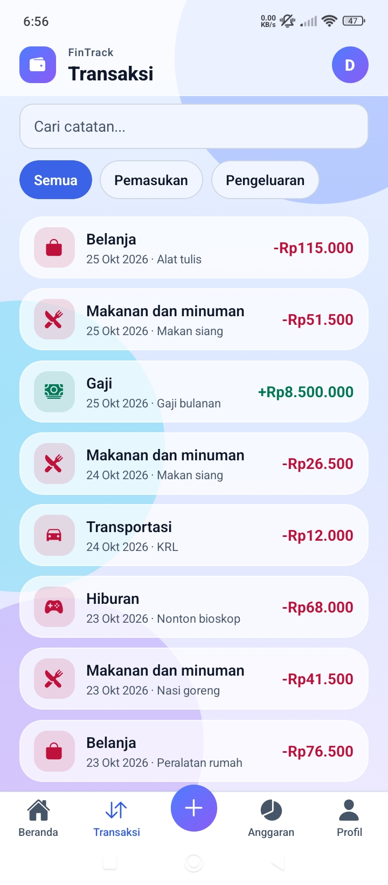
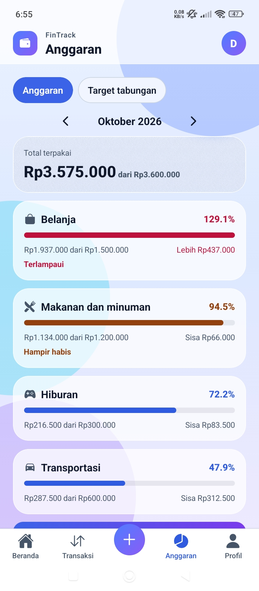
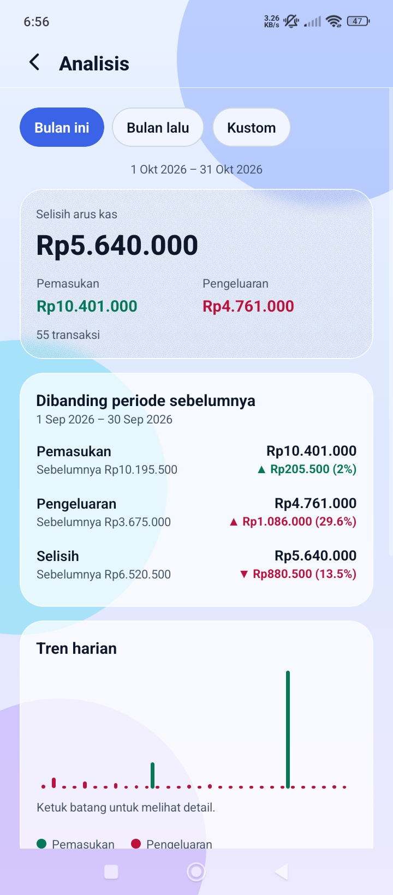
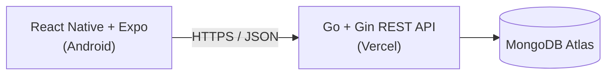
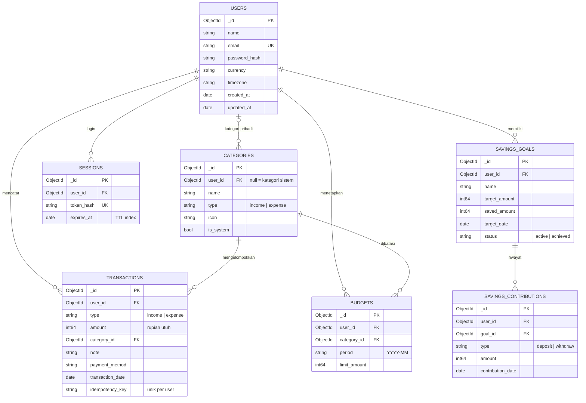

# FinTrack — Personal Finance Tracker

Aplikasi mobile untuk mencatat transaksi, mengontrol anggaran bulanan, dan memantau target tabungan, dengan antarmuka _Modern Glass Finance_ (glassmorphism). Dibangun penuh dari nol: aplikasi React Native, REST API Go, dan database MongoDB.

> Prinsip pengembangan: **kebenaran data keuangan dan keamanan lebih dulu**, baru visual.

## Screenshots

|                      Beranda                      |                         Transaksi                          |                       Anggaran                       |                        Analisis                         |
| :-----------------------------------------------: | :--------------------------------------------------------: | :--------------------------------------------------: | :-----------------------------------------------------: |
|                   **Dark Mode**                   |                       **Dark Mode**                        |                    **Dark Mode**                     |                      **Dark Mode**                      |
|    |    |    |    |
|                  **Light Mode**                   |                       **Light Mode**                       |                    **Light Mode**                    |                     **Light Mode**                      |
|  |  |  |  |

- **Download APK:** [FinTrack v1.0.0](https://github.com/fazdajulioarzika/fintrack-GoReactNative/releases/download/v1.0.0/FinTrack.v1.0.0.apk)

## Akun demo (data fiktif)

|          |                     |
| -------- | ------------------- |
| Email    | `demo@fintrack.app` |
| Password | `Demo12345`         |

## Fitur

- **Autentikasi**: registrasi, login, logout, sesi dengan refresh token yang dirotasi, hapus akun dengan konfirmasi password.
- **Dashboard**: saldo, pemasukan/pengeluaran bulan berjalan, grafik arus kas harian, ringkasan kategori, progres anggaran, transaksi terbaru.
- **Transaksi**: tambah, ubah, hapus, detail; filter jenis, pencarian catatan, scroll tak terbatas; kategori default.
- **Anggaran**: batas per kategori per bulan dengan status _normal / hampir habis / terlampaui_.
- **Target tabungan**: setoran dan penarikan dengan riwayat, progres, dan status tercapai otomatis.
- **Analisis**: bulan ini / bulan lalu / rentang kustom, tren harian atau bulanan, perbandingan dengan periode sebelumnya.
- **Pengaturan**: ubah nama, zona waktu (WIB/WITA/WIT), tema terang/gelap/sistem.
- Setiap layar data punya state _loading_, _kosong_, _error_, dan validasi formulir.

## Teknologi

| Lapisan  | Teknologi                                                                                                        |
| -------- | ---------------------------------------------------------------------------------------------------------------- |
| Mobile   | React Native, Expo, TypeScript, Expo Router, TanStack Query, React Hook Form + Zod, expo-secure-store, expo-blur |
| Backend  | Go, Gin, MongoDB Go Driver v2, JWT, bcrypt                                                                       |
| Database | MongoDB Atlas                                                                                                    |
| Deploy   | Vercel (backend), EAS Build (APK)                                                                                |

## Arsitektur



Backend adalah **sumber kebenaran** untuk transaksi, saldo, anggaran, dan progres tabungan. Aplikasi mobile hanya menampilkan dan tidak menjadi satu-satunya tempat validasi aturan bisnis.

```
fintrack/
├── backend/
│   ├── cmd/api/            # titik masuk server
│   ├── cmd/seed/           # pembuat akun demo
│   ├── internal/
│   │   ├── config/ database/ models/ auth/
│   │   ├── middleware/     # autentikasi, rate limit, CORS, header keamanan
│   │   ├── handlers/       # logika tiap endpoint
│   │   ├── server/         # perakitan router
│   │   └── integration/    # tes integrasi + keamanan
│   └── docs/API.md         # dokumentasi REST API
└── mobile/
    └── src/
        ├── app/            # layar (Expo Router)
        ├── components/     # komponen UI (GlassCard, Chip, DateField, ...)
        ├── context/        # Auth
        ├── lib/            # klien API, format, tanggal
        └── theme/          # warna, tema terang/gelap
```

## Model data (ERD)



Anggaran unik per `(user_id, category_id, period)`. Saldo dan pemakaian anggaran **tidak disimpan**, selalu dihitung dari transaksi.

## Keputusan teknis

- **Uang sebagai `int64`** (rupiah utuh), tanpa floating-point; batas nominal untuk mencegah overflow.
- **Saldo tidak disimpan**: dihitung dengan agregasi MongoDB, sehingga edit atau hapus transaksi otomatis konsisten di dashboard, anggaran, dan analisis.
- **Zona waktu per pengguna**: tanggal disimpan UTC; batas hari dan bulan dihitung di backend menurut zona waktu pengguna.
- **Sesi aman**: access token JWT 15 menit + refresh token acak (hanya hash SHA-256 yang disimpan), dirotasi setiap dipakai dan dicabut saat logout. Di perangkat disimpan lewat `expo-secure-store`.
- **Anti-duplikasi**: header `Idempotency-Key` pada pembuatan transaksi dan kontribusi tabungan, dijamin unique index.
- **Konsistensi tabungan**: setoran/penarikan mengubah riwayat dan saldo target dalam satu **transaksi MongoDB**; penarikan melebihi saldo ditolak, termasuk saat request bersamaan.
- **Kepemilikan data**: `user_id` selalu diambil dari token, tidak pernah dari input. Data milik pengguna lain dijawab `404`.
- **Pencarian aman**: input pencarian diperlakukan sebagai teks, bukan pola regex.
- **Aksesibilitas warna**: kontras teks diukur terhadap WCAG AA; warna teks pada chip dipilih otomatis (putih/gelap) berdasarkan latar.
- **Glassmorphism seperlunya**: blur dipakai hanya di kartu utama; kartu lain dan formulir memakai latar semi-transparan atau solid agar teks tetap terbaca dan performa terjaga.

## Menjalankan secara lokal

### Backend

```bash
cd backend
cp .env.example .env        # isi MONGO_URI (MongoDB Atlas) dan JWT_SECRET (>= 32 karakter)
go mod tidy
go run ./cmd/api            # http://localhost:8080/health
go run ./cmd/seed           # opsional: akun demo berisi data fiktif
```

### Mobile

```bash
cd mobile
npm install
echo "EXPO_PUBLIC_API_URL=http://IP-LAPTOP:8080/api/v1" > .env
npx expo start -c           # scan QR dengan Expo Go
```

HP tidak bisa mengakses `localhost` laptop; pakai IP laptop di jaringan Wi-Fi yang sama.

## Pengujian

```bash
cd backend
go vet ./...
go test ./internal/handlers/                      # unit test aturan bisnis
TEST_MONGO_URI="mongodb+srv://..." go test ./internal/integration/ -v -count=1
```

Tes integrasi memakai database sementara yang dihapus otomatis dan mencakup: alur autentikasi, token palsu/kedaluwarsa/algoritma `none`, isolasi data antar-pengguna, validasi nominal dan kategori, anti-duplikasi, konsistensi saldo, status anggaran, alur tabungan (termasuk penarikan bersamaan), analitik, dan penghapusan akun.

## Dokumentasi API

Lihat [`backend/docs/API.md`](backend/docs/API.md).

## Deployment

- **Backend**: Vercel (runtime Go), variabel lingkungan `MONGO_URI`, `MONGO_DB`, `JWT_SECRET`, `APP_ENV=production`, `SKIP_DB_SETUP=true`, `CLIENT_IP_HEADER=X-Forwarded-For`.
- **APK**: `eas build --platform android --profile preview`.

## Batasan yang diketahui

- Rate limiter tersimpan di memori per instance (lebih lemah di lingkungan serverless).
- Access token tetap berlaku sampai kedaluwarsa (maks. 15 menit) meski sesi sudah dicabut.
- Belum ada ganti password, kategori buatan sendiri, ekspor CSV, notifikasi anggaran, dan PIN/biometrik (pasca-MVP di PRD).

## Rencana berikutnya

Ekspor CSV, transaksi berulang dan pengingat tagihan, notifikasi anggaran, PIN/biometrik, multi-mata uang, serta pengelolaan rekening/dompet terpisah.
